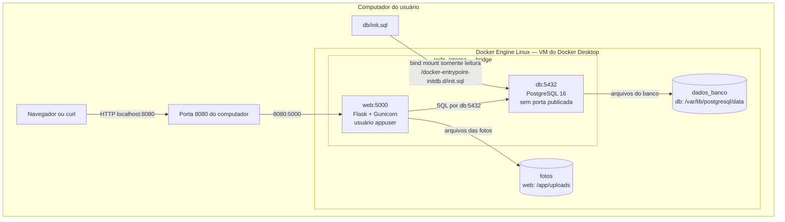

# Arquitetura

Web e db estão dentro da rede `rede_interna`. O DNS do Docker permite que web encontre o banco pelo nome `db`. A porta 5432 não é publicada no computador.

O cliente, o arquivo SQL e os volumes ficam fora da rede: eles não são participantes de rede. Os volumes são montados nos contêineres. No Docker Desktop usado nos testes, os dados ficam no ambiente Linux do Docker.

O nome `rede_interna` foi escolhido no Compose e não ativa a opção `internal: true`. Os nomes criados pelo Docker têm o prefixo do projeto: `achados-perdidos_rede_interna`, `achados-perdidos_fotos` e `achados-perdidos_dados_banco`.

As inspeções estão na [evidência 05](evidencias/05-volumes-rede-imagem.txt) e no [relatório com capturas](RELATORIO_TESTES.md). A versão com nginx e Adminer está no [diagrama dos bônus](bonus/README.md).
