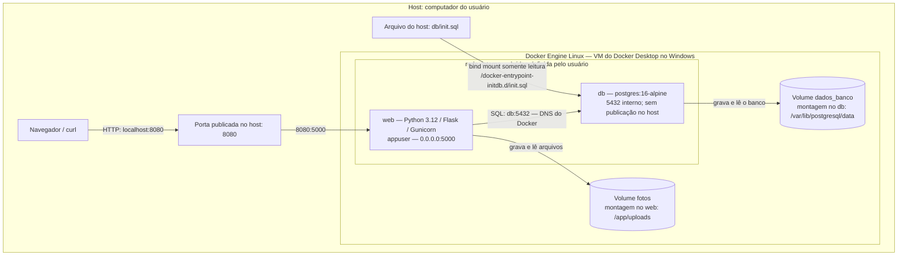

# Arquitetura principal

Somente `web` e `db` são participantes da `rede_interna`. O cliente, a porta do host, o arquivo SQL e os volumes ficam fora dessa rede: arquivos e volumes são armazenamento montado, não participantes de rede. O host hospeda o Engine; no Docker Desktop deste teste, os volumes ficam no disco da VM Linux.

O nome `rede_interna` identifica a rede bridge do projeto; não configura a opção Docker `internal: true`. O isolamento exigido é obtido com rede própria e ausência de publicação da porta do banco. `5432/tcp` em `docker compose ps` indica a porta do contêiner, sem um mapeamento `host->contêiner`.

O Compose prefixou os nomes como `achados-perdidos_rede_interna`, `achados-perdidos_fotos` e `achados-perdidos_dados_banco`. A [inspeção real](evidencias/05-volumes-rede-imagem.txt) mostra os dois contêineres na rede. A arquitetura opcional com proxy está no [diagrama dos bônus](bonus/README.md).
