# Relatório dos testes

Testes realizados em 17/10/2026. Clique nas imagens para abrir os arquivos originais.

## 01. Consulta de saúde

GET /health retornou HTTP 200, status ok e banco conectado.

[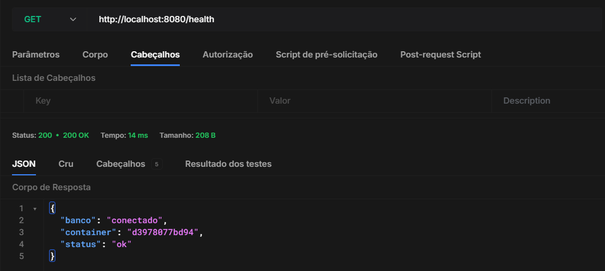](evidencias/capturas/01-health.png)

## 02. Serviços em execução

O docker compose ps mostrou web em execução, db saudável e a publicação 8080:5000 apenas em web.

[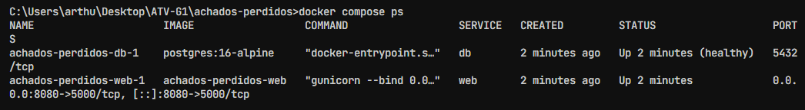](evidencias/capturas/02-servicos.png)

## 03. Listagem dos itens

GET /itens retornou os três objetos de exemplo cadastrados pelo init.sql.

[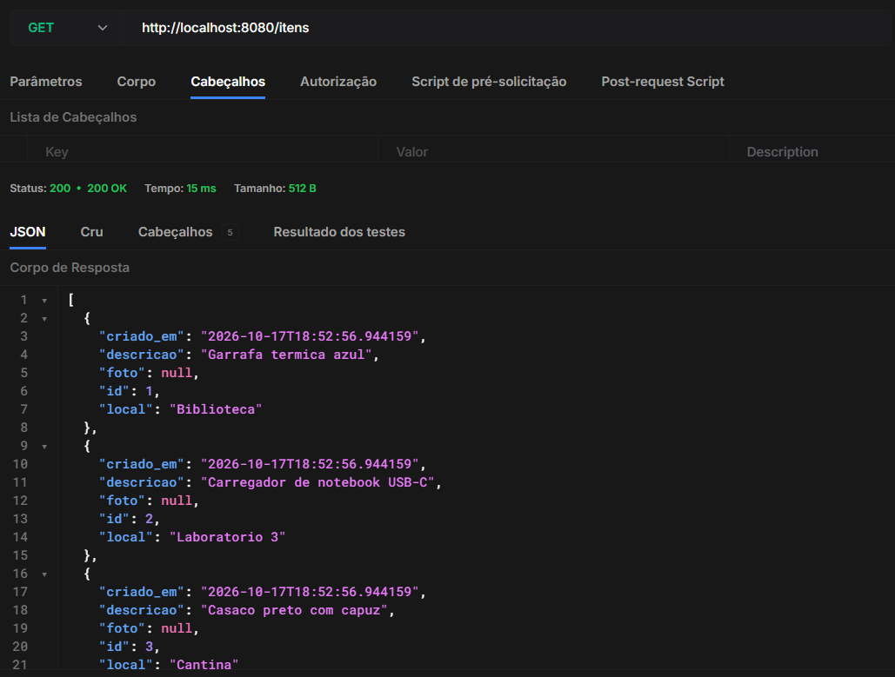](evidencias/capturas/03-listagem.png)

## 04. Filtro por local

A consulta com local=biblio retornou somente a garrafa cadastrada na Biblioteca.

[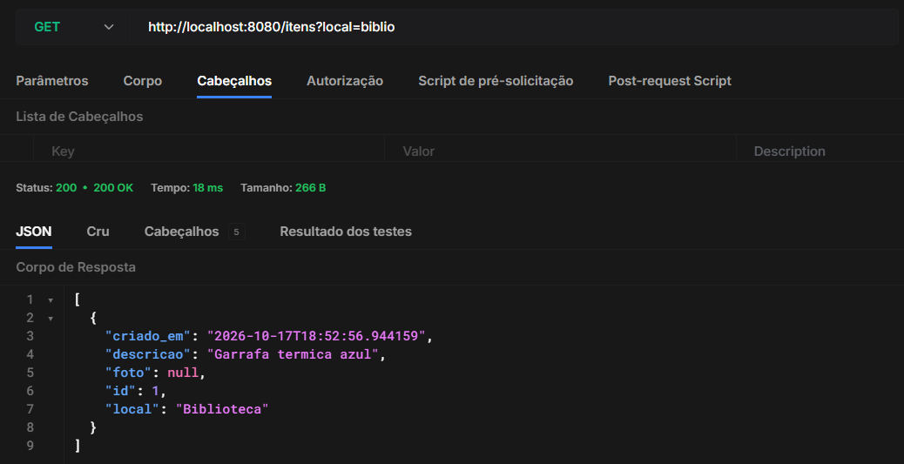](evidencias/capturas/04-filtro-local.png)

## 05. Estatísticas após o cadastro

Depois do primeiro cadastro com foto, a API informou quatro itens no banco e uma foto no volume.

[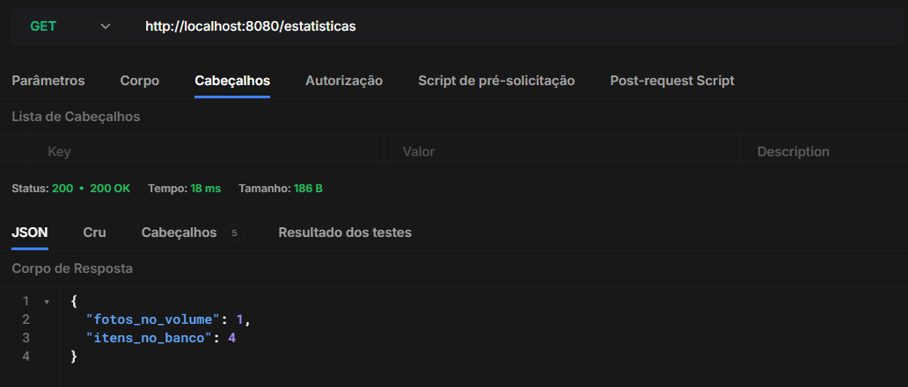](evidencias/capturas/05-estatisticas.png)

## 06. Foto no navegador

A foto dos óculos foi aberta pela rota `/fotos/<nome>` e apareceu no navegador.

[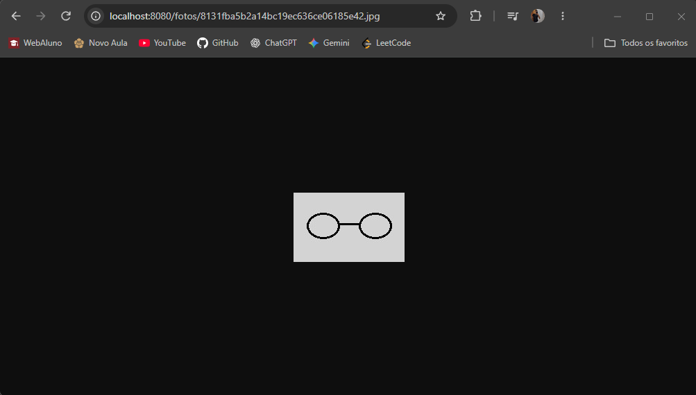](evidencias/capturas/06-foto-navegador.png)

## 07. Usuário do contêiner

O comando docker compose exec web whoami retornou appuser. A aplicação executa sem root.

[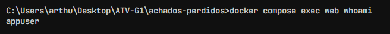](evidencias/capturas/07-usuario.png)

## 08. Logs de web

O log mostrou o encerramento do worker 7 e a criação do worker 8. Na consulta completa foi identificado um timeout; a verificação posterior de /health respondeu normalmente.

[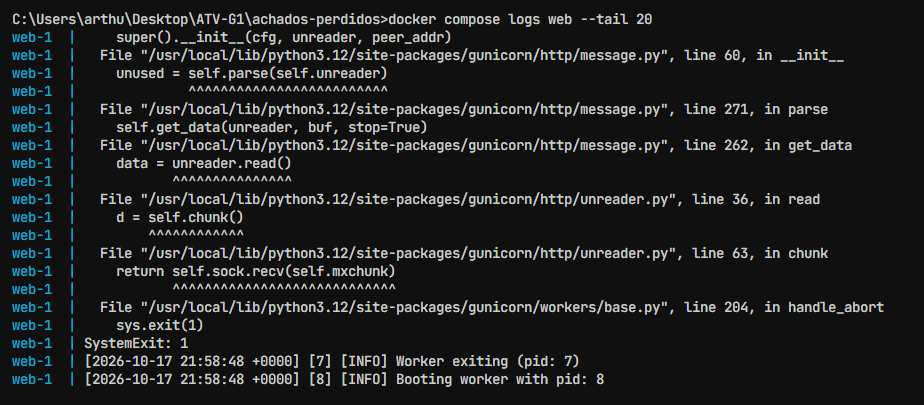](evidencias/capturas/08-logs-web.png)

## 09. Preparação da persistência

Após mais dois cadastros com foto, as estatísticas ficaram em seis itens e três fotos. Esse foi o estado usado na comparação.

[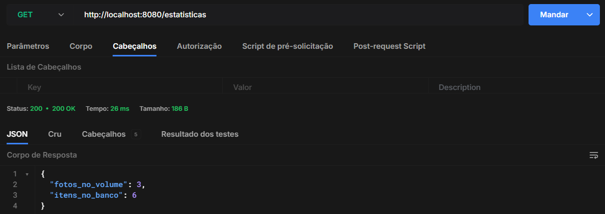](evidencias/capturas/09-antes-recriacao.png)

## 10. Recriação do ambiente

Após down, o comando up -d criou novamente os contêineres e a rede. O banco ficou saudável.

[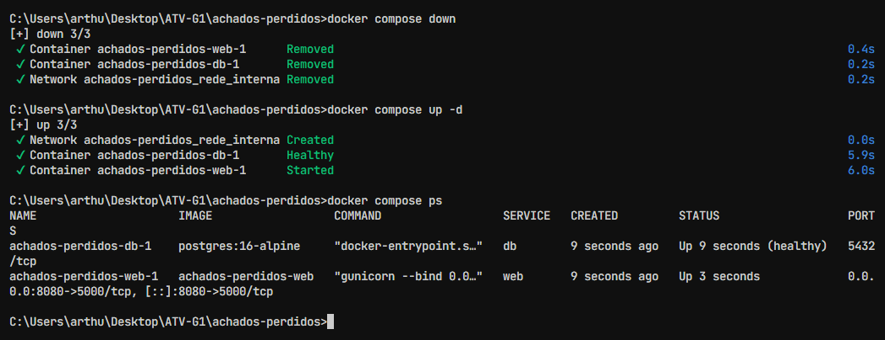](evidencias/capturas/11-recriacao.png)

## 11. Dados depois da recriação

As consultas mantiveram seis itens e três fotos. Os cadastros anteriores continuaram na listagem.

[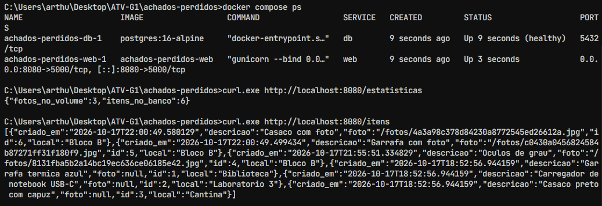](evidencias/capturas/12-persistencia.png)

## 12. Lista dos volumes

O Docker listou os volumes dados_banco e fotos, com o prefixo achados-perdidos. As estatísticas continuaram em seis itens e três fotos.

[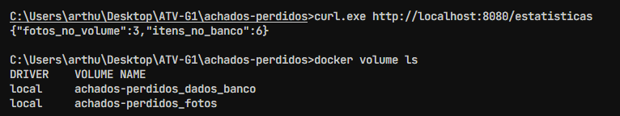](evidencias/capturas/13-lista-volumes.png)

## 13. Caminhos dos volumes

O volume inspect mostrou os dois volumes e seus Mountpoints em /var/lib/docker/volumes, no ambiente Linux do Docker.

[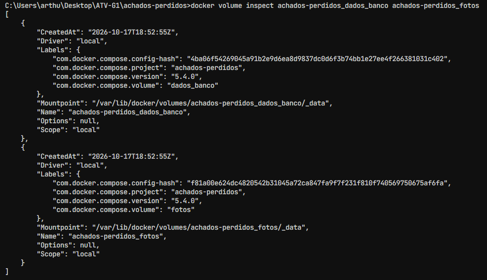](evidencias/capturas/14-inspecao-volumes.png)

## 14. Arquivos no volume fotos

O diretório /app/uploads continha três arquivos JPG, pertencentes a appuser.

[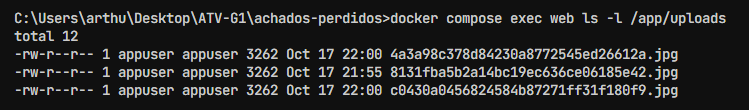](evidencias/capturas/15-arquivos-fotos.png)

## 15. Remoção dos volumes

Antes de down -v havia seis itens e três fotos. Depois da remoção, o inspect retornou no such volume para os dois volumes, como esperado.

[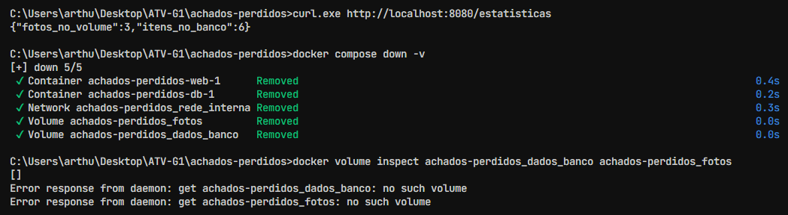](evidencias/capturas/16-remocao-volumes.png)

## 16. Subida com volumes novos

A nova subida criou dados_banco e fotos novamente. Os dois serviços iniciaram, com db saudável.

[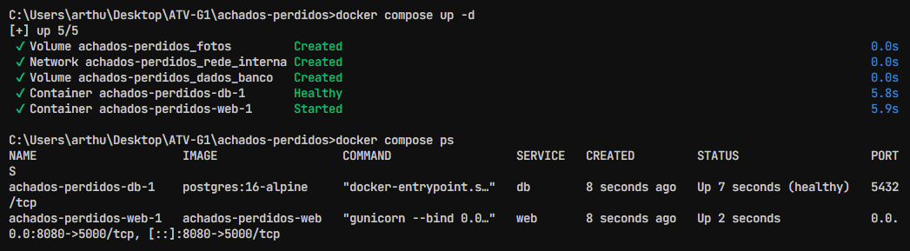](evidencias/capturas/17-volumes-novos.png)

## 17. Resultado da reinicialização

As consultas mostraram três itens e zero fotos. Voltaram os exemplos do init.sql, e /app/uploads ficou vazio.

[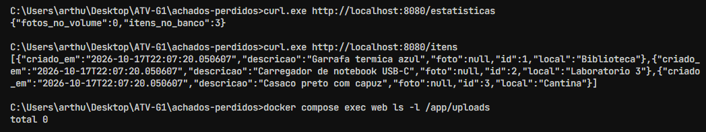](evidencias/capturas/18-reinicializacao.png)

## 18. Inspeção da rede

O network inspect mostrou a rede achados-perdidos_rede_interna com driver bridge e os dados de conexão dos contêineres.

[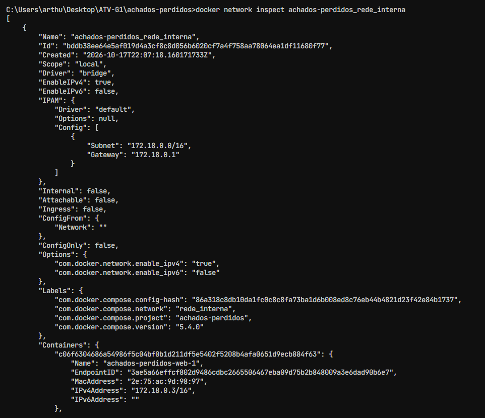](evidencias/capturas/19-rede.png)

## 19. Imagens e tamanho

O image ls mostrou a imagem web com 219 MB de uso em disco e 53,8 MB de conteúdo. A imagem do banco é postgres:16-alpine.

[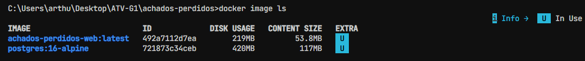](evidencias/capturas/20-imagens.png)

## 20. Tamanho em bytes

O campo Size da imagem web retornou 53758665 bytes.

[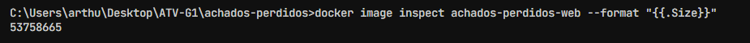](evidencias/capturas/21-tamanho-bytes.png)

## 21. Escala para três instâncias

A tentativa com --scale web=3 falhou porque a primeira instância já ocupava a porta 8080 do computador.

[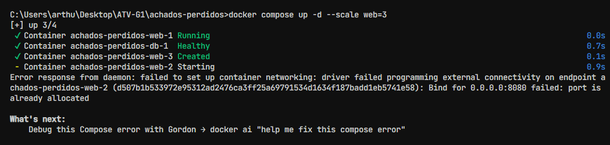](evidencias/capturas/22-escala.png)

## 22. Volta para uma instância

O comando --scale web=1 removeu as instâncias adicionais. Web e db continuaram ativos, e /health retornou ok e conectado.

[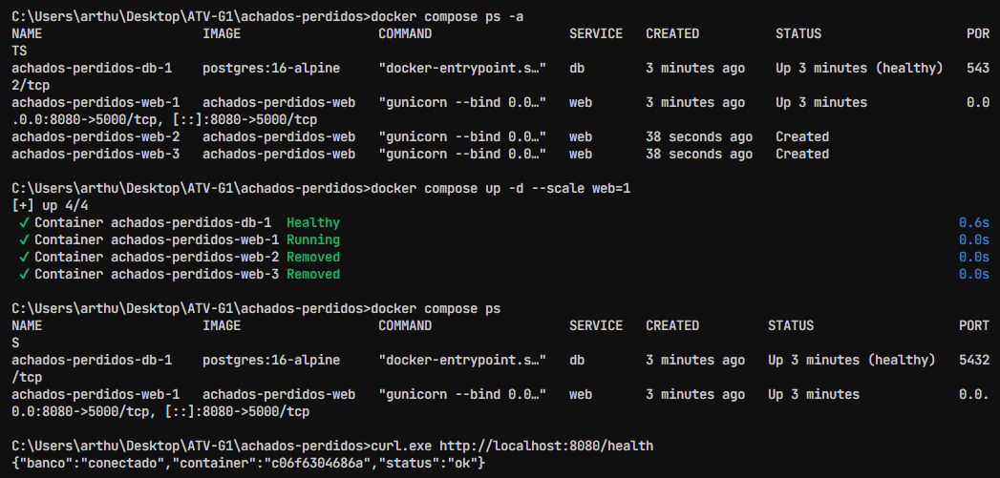](evidencias/capturas/24-retorno-uma-instancia.png)

## 23. Ativação do nginx

A configuração principal foi encerrada e a subida passou a usar também docs/bonus/docker-compose.bonus.yml.

[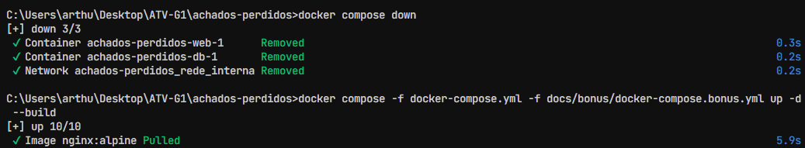](evidencias/capturas/25-inicio-nginx.png)

## 24. Subida da configuração de bônus

A imagem de web foi construída e os serviços db, web e nginx iniciaram.

[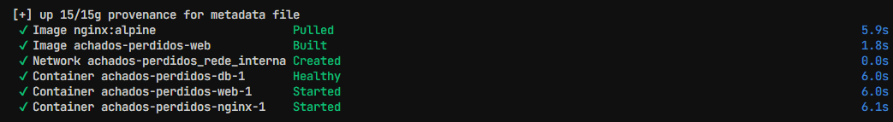](evidencias/capturas/26-nginx-iniciado.png)

## 25. Portas com o proxy

Somente nginx publicou a porta 8080 da API. Web ficou com a porta 5000 interna, e db permaneceu sem publicação.

[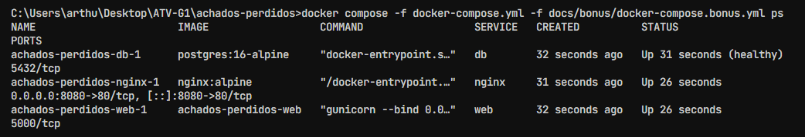](evidencias/capturas/27-portas-nginx.png)

## 26. API pelo nginx

GET /health retornou ok e conectado. Os cabeçalhos mostraram HTTP 200 e Server: nginx/1.31.7.

[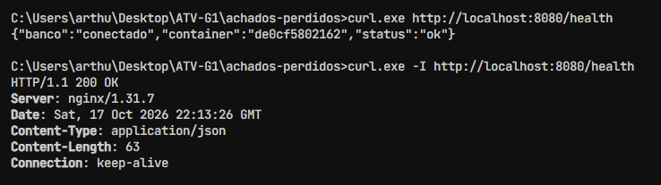](evidencias/capturas/28-health-nginx.png)

## 27. Ativação do profile debug

O comando com --profile debug iniciou o Adminer junto dos serviços da configuração de bônus.

[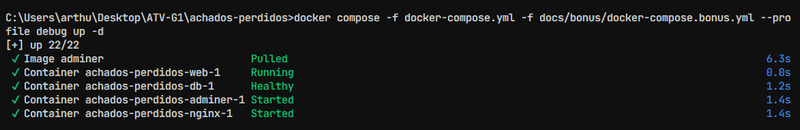](evidencias/capturas/29-ativacao-adminer.png)

## 28. Serviços com debug

O Adminer apareceu em execução com a publicação 8081:8080. Nginx manteve a porta 8080, e db ficou saudável.

[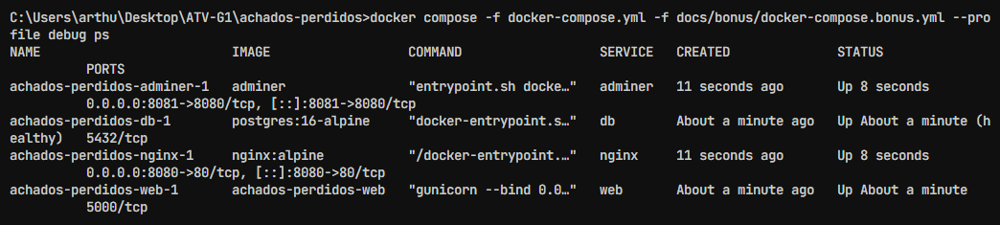](evidencias/capturas/30-servicos-debug.png)

## 29. Formulário do Adminer

O formulário foi preenchido para PostgreSQL no servidor db, com usuário usuario_exemplo e banco achados_exemplo. A senha está mascarada na captura.

[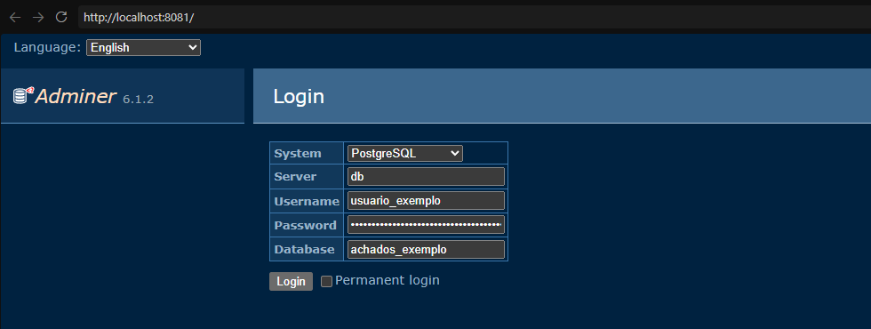](evidencias/capturas/31-login-adminer.png)

## 30. Conexão pelo Adminer

Após o login, o painel mostrou o esquema public e a tabela itens do banco achados_exemplo.

[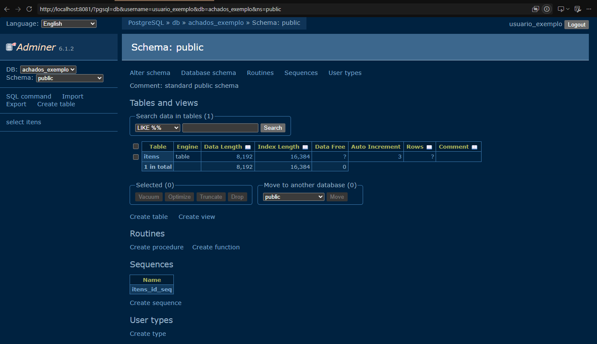](evidencias/capturas/32-adminer-conectado.png)

## 31. Estrutura da tabela

O Adminer mostrou as colunas id, descricao, local, foto e criado_em, de acordo com o init.sql.

[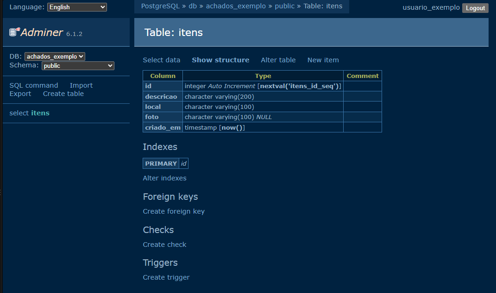](evidencias/capturas/33-estrutura-itens.png)

## 32. Consulta pelo Adminer

A consulta retornou os três objetos de exemplo. Todos estavam com foto NULL, conforme a inicialização do banco.

[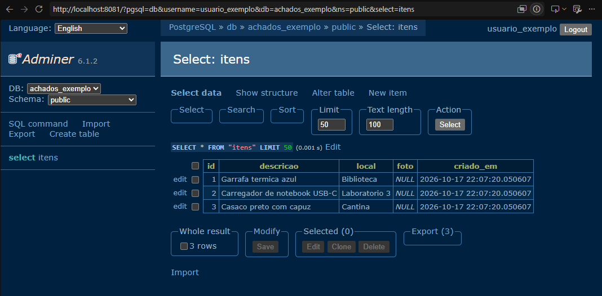](evidencias/capturas/34-dados-adminer.png)

## 33. Foto usada no backup

Um POST enviado pelo nginx retornou HTTP 201 e ID 4. As estatísticas passaram de três itens e zero fotos para quatro itens e uma foto.

[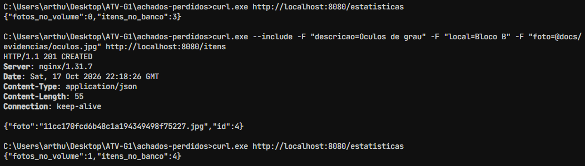](evidencias/capturas/35-foto-para-backup.png)

## 34. Criação do backup

Web foi pausado e um contêiner temporário Alpine gerou fotos-reteste.tar.gz a partir do volume fotos, montado somente para leitura.

[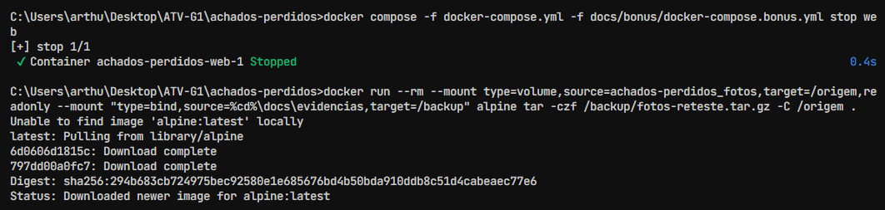](evidencias/capturas/36-backup.png)

## 35. Conteúdo do backup

O tar listou a foto dentro do arquivo de backup. Depois, web foi iniciado novamente.

[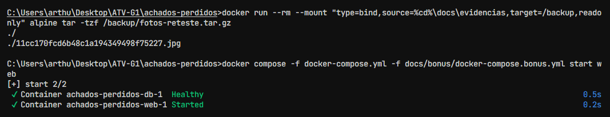](evidencias/capturas/37-conteudo-backup.png)

## 36. Restauração e comparação

O backup foi extraído em um volume novo. O diff não encontrou diferenças, os hashes SHA256 foram iguais e a foto manteve 3262 bytes e UID/GID 1000.

[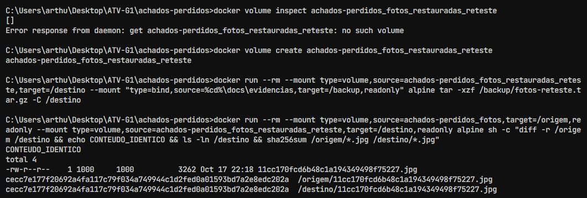](evidencias/capturas/38-restauracao.png)

## 37. Limpeza e estado final

O volume temporário, nginx e Adminer foram removidos. A configuração principal voltou com web e db, health normal, quatro itens e uma foto.

[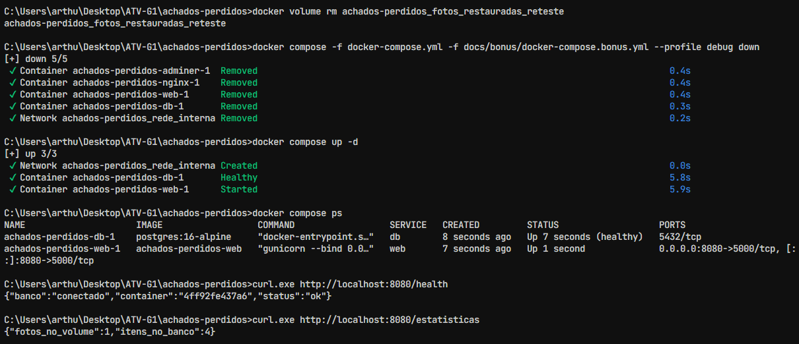](evidencias/capturas/39-volta-principal.png)
