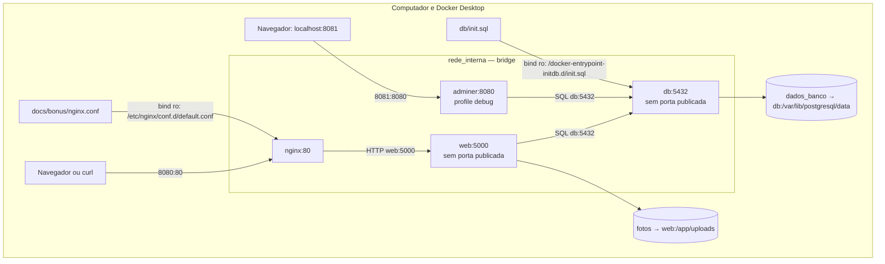

# Bônus

Os bônus ficam em `docs/bonus/docker-compose.bonus.yml`. A configuração principal continua com apenas web e db. Os comandos desta página usam o Prompt de Comando do Windows (cmd), na pasta `achados-perdidos`.

O arquivo de bônus usa `!reset` para retirar a publicação de web. Isso precisa de Docker Compose 2.24.4 ou superior; os testes usaram a versão 5.4.0 ([documentação](https://docs.docker.com/reference/compose-file/merge/)).

## 1. nginx

Encerre a configuração principal e suba os dois arquivos:

```cmd
docker compose down
docker compose -f docker-compose.yml -f docs/bonus/docker-compose.bonus.yml up -d --build
docker compose -f docker-compose.yml -f docs/bonus/docker-compose.bonus.yml ps
curl.exe http://localhost:8080/health
curl.exe -I http://localhost:8080/health
```

Nginx publica 8080:80 e encaminha as requisições para `web:5000`. Web fica sem porta publicada no computador. Nos testes, o health respondeu normalmente, e os cabeçalhos mostraram `Server: nginx/1.31.7`.



Os contêineres participam da rede. Os clientes, arquivos e volumes ficam fora dela. O proxy deste bônus foi testado com uma instância de web; a escala para três instâncias é discutida na Q7.

## 2. Adminer

O serviço tem `profiles: ["debug"]`. Para iniciá-lo:

```cmd
docker compose -f docker-compose.yml -f docs/bonus/docker-compose.bonus.yml --profile debug up -d
docker compose -f docker-compose.yml -f docs/bonus/docker-compose.bonus.yml --profile debug ps
```

Abra `http://localhost:8081`. Escolha PostgreSQL, use `db` como servidor e preencha usuário, senha e banco com os valores do seu `.env`.

Nos testes guiados, o login funcionou. A tabela `itens` mostrou as cinco colunas e os três exemplos, todos com foto NULL. As capturas estão no [relatório de testes](../RELATORIO_TESTES.md).

## 3. Backup e restauração de fotos

Execute depois de cadastrar uma foto. O nome dos volumes abaixo considera a pasta do projeto chamada `achados-perdidos`.

Pause web e crie o backup em `docs/evidencias/fotos-reteste.tar.gz`:

```cmd
docker compose -f docker-compose.yml -f docs/bonus/docker-compose.bonus.yml stop web
docker run --rm --mount type=volume,source=achados-perdidos_fotos,target=/origem,readonly --mount "type=bind,source=%cd%\docs\evidencias,target=/backup" alpine tar -czf /backup/fotos-reteste.tar.gz -C /origem .
docker run --rm --mount "type=bind,source=%cd%\docs\evidencias,target=/backup,readonly" alpine tar -tzf /backup/fotos-reteste.tar.gz
docker compose -f docker-compose.yml -f docs/bonus/docker-compose.bonus.yml start web
```

Confira se o volume de restauração ainda não existe:

```cmd
docker volume inspect achados-perdidos_fotos_restauradas_reteste
```

O resultado esperado é `no such volume`. Se já existir, escolha outro nome novo e ajuste os próximos comandos.

Crie o volume, restaure o arquivo e compare o conteúdo:

```cmd
docker volume create achados-perdidos_fotos_restauradas_reteste
docker run --rm --mount type=volume,source=achados-perdidos_fotos_restauradas_reteste,target=/destino --mount "type=bind,source=%cd%\docs\evidencias,target=/backup,readonly" alpine tar -xzf /backup/fotos-reteste.tar.gz -C /destino
docker run --rm --mount type=volume,source=achados-perdidos_fotos,target=/origem,readonly --mount type=volume,source=achados-perdidos_fotos_restauradas_reteste,target=/destino,readonly alpine sh -c "diff -r /origem /destino && echo CONTEUDO_IDENTICO && ls -ln /destino && sha256sum /origem/*.jpg /destino/*.jpg"
```

No teste guiado, o diff não encontrou diferenças. A foto original e a restaurada tinham 3262 bytes, o mesmo SHA256 e proprietário/grupo 1000. Depois da conferência, o volume temporário foi removido:

```cmd
docker volume rm achados-perdidos_fotos_restauradas_reteste
```

Esse backup contém as fotos, não os registros do banco. O arquivo é gerado pelos comandos acima e não é versionado. A criação e a restauração estão comprovadas nas capturas do [relatório de testes](../RELATORIO_TESTES.md).

## Voltar à configuração principal

```cmd
docker compose -f docker-compose.yml -f docs/bonus/docker-compose.bonus.yml --profile debug down
docker compose up -d
docker compose ps
curl.exe http://localhost:8080/health
curl.exe http://localhost:8080/estatisticas
```

Sem `-v`, os volumes são mantidos. Ao terminar, ficaram apenas web e db, com health normal, quatro itens e uma foto.
