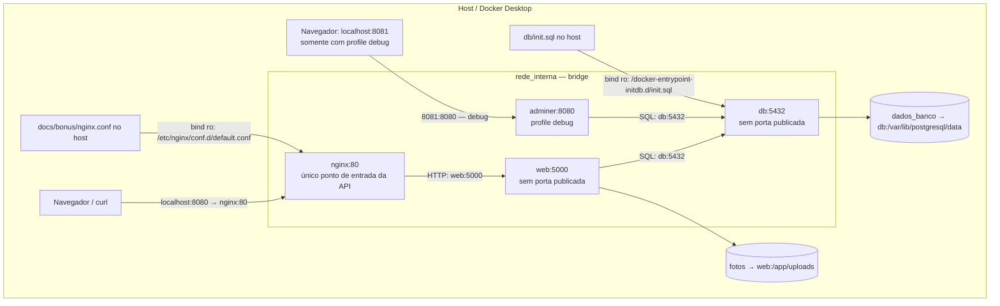

# Bônus da seção 6

A solução principal continua em `docker-compose.yml`, com somente web e db. Os serviços opcionais ficam em `docs/bonus/docker-compose.bonus.yml` e são ativados explicitamente com `-f`. Execute os comandos desta página na raiz `achados-perdidos/`, com o `.env` já configurado. O override usa `!reset`, suportado no Docker Compose 2.24.4 ou superior ([documentação de merge](https://docs.docker.com/reference/compose-file/merge/)); foi testado no Compose v5.4.0.

## Proxy nginx (+0,4)

Encerre a configuração principal para liberar 8080 e suba a composição dos dois arquivos:

```powershell
docker compose down
docker compose -f docker-compose.yml -f docs/bonus/docker-compose.bonus.yml up -d --build
docker compose -f docker-compose.yml -f docs/bonus/docker-compose.bonus.yml ps
curl.exe http://localhost:8080/health
curl.exe -I http://localhost:8080/health
```

O override limpa `ports` de web, monta `nginx.conf` somente para leitura e publica `8080:80` exclusivamente no proxy para a API. `proxy_pass http://web:5000` encaminha as rotas existentes. Os mesmos volumes e configurações do banco são preservados. A [evidência 09](../evidencias/09-bonus-proxy-adminer.txt) mostra web apenas com `5000/tcp`, nginx com a publicação 8080 e HTTP 200 pelo proxy.



Contêineres são os participantes da rede; clientes, arquivos de configuração e volumes ficam fora dela. O painel de debug usa 8081, sem publicar 5432 do banco. O proxy deste bônus encaminha a uma instância web; a discussão de balanceamento para três réplicas está em Q7, sem modificar a arquitetura obrigatória.

## Backup e restauração de fotos (+0,3)

O procedimento abaixo usa a configuração principal e o nome de projeto derivado da pasta `achados-perdidos`. Execute com fotos já cadastradas, antes de qualquer `down -v`. Pare web durante a cópia para impedir alterações concorrentes nos arquivos. Os comandos PowerShell usam contêineres temporários e não instalam ferramentas no host:

```powershell
docker compose stop web
$backupPath = (Resolve-Path ./docs/evidencias).Path
docker run --rm --mount type=volume,source=achados-perdidos_fotos,target=/origem,readonly --mount "type=bind,source=$backupPath,target=/backup" alpine tar -czf /backup/fotos.tar.gz -C /origem .
docker volume create achados-perdidos_fotos_restauradas
docker run --rm --mount type=volume,source=achados-perdidos_fotos_restauradas,target=/destino --mount "type=bind,source=$backupPath,target=/backup,readonly" alpine tar -xzf /backup/fotos.tar.gz -C /destino
docker run --rm --mount type=volume,source=achados-perdidos_fotos,target=/origem,readonly --mount type=volume,source=achados-perdidos_fotos_restauradas,target=/destino,readonly alpine sh -c 'diff -r /origem /destino && ls -ln /destino && sha256sum /origem/*.jpg /destino/*.jpg'
docker compose start web
```

Use um nome ainda inexistente para o volume de restauração; `volume create` não esvazia um volume existente. O `diff` deve sair com código 0 e os hashes de cada arquivo devem coincidir. A [evidência 07](../evidencias/07-bonus-backup.txt) demonstra a restauração de três fotos em um volume novo, os hashes iguais e a preservação do proprietário UID/GID 1000. O arquivo real está em [fotos.tar.gz](../evidencias/fotos.tar.gz). É um backup das fotos daquele momento; ele não contém o banco nem recupera sozinho os registros SQL.

Após a demonstração, removi apenas o volume temporário restaurado, como registrado na evidência. Para fazer a mesma limpeza:

```powershell
docker volume rm achados-perdidos_fotos_restauradas
```

## Adminer com profile debug (+0,3)

O serviço declara literalmente `profiles: ["debug"]`. Sem esse profile ele não inicia. Para ativá-lo com a configuração de bônus:

```powershell
docker compose -f docker-compose.yml -f docs/bonus/docker-compose.bonus.yml --profile debug up -d
```

Abra `http://localhost:8081`. Selecione PostgreSQL, servidor `db`, e informe banco, usuário e senha definidos no seu `.env`. Não use `localhost` como servidor dentro do painel. A [evidência 09](../evidencias/09-bonus-proxy-adminer.txt) mostra primeiro a composição sem Adminer, depois a ativação com debug e a resposta HTTP 200 do painel. O login interativo não foi executado; a conexão SQL já foi comprovada pela API.

## Voltar à configuração principal

```powershell
docker compose -f docker-compose.yml -f docs/bonus/docker-compose.bonus.yml --profile debug down
docker compose up -d
```

Sem `-v`, os volumes são preservados. A evidência 09 registra a remoção dos serviços opcionais, a volta da publicação `8080:5000` em web e a conexão normal ao banco.
